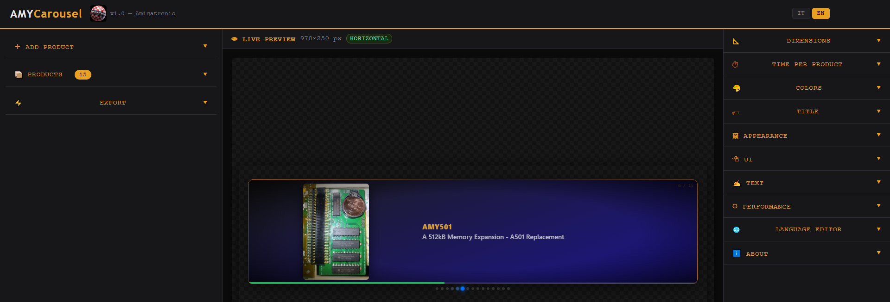
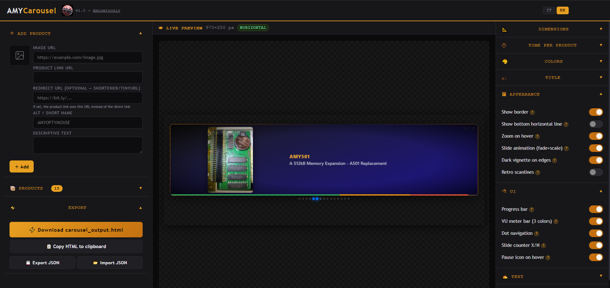
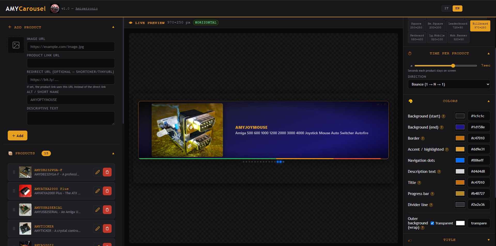

# 🎠 AMYCarousel

**A visual editor that generates pure-CSS product carousels — no JavaScript in the output.**

Build a rotating product banner in your browser (or as a standalone Windows app), tweak it live, then copy or download a single self-contained HTML snippet ready to paste into any shop page, product description or website.

[](LICENSE)






<!-- Add a screenshot here, e.g. docs/screenshot.png:

-->

---

## ✨ Features

- **Pure CSS output** — the generated carousel uses `@keyframes` only: no scripts, no dependencies, safe for platforms that strip JavaScript.
- **Live preview** — every change is rendered instantly in the preview pane.
- **Product manager** — add, edit, delete and drag-and-drop reorder products (image URL, link, optional redirect URL, short name, description).
- **Slide direction** — *Forward* (1 → N), *Backward* (N → 1) or *Bounce* (1 → N → 1), like the front scanner of a certain famous talking car.
- **Comet-tail dot navigation** — in bounce mode the active dot leaves a soft fading tail that follows the direction of travel.
- **Customizable look** — banner size with IAB presets, seconds per product, colors (background, border, accent, dots, text, title, progress bar, divider, outer background), title text and link.
- **Optional effects** — slide animation (fade + scale), hover zoom, border, vignette, scanlines, pause-on-hover icon, divider line, name highlight.
- **Navigation aids** — dot navigation, progress bar (simple or VU-meter style) and `X / N` slide counter.
- **Performance flags** — lazy image loading and `content-visibility`.
- **Adaptive layout** — vertical, horizontal and narrow layouts chosen from the banner size.
- **Bilingual UI** — Italian / English, with a built-in language string editor.
- **Auto-save and JSON import/export** — your products and settings are kept between sessions and can be backed up or shared.
- **Single file** — the whole editor is one `AMYCarousel.htm`; open it in any modern browser.

---

## 🚀 Quick start

### Option 1 — In the browser

1. Download `AMYCarousel.htm`.
2. Open it in a modern browser (Chrome, Edge, Firefox, Safari).
3. Add your products, adjust the options and export.

### Option 2 — Standalone Windows app

The editor can be wrapped into a native window with [pywebview](https://pywebview.flowrl.com/) and packed into a single `.exe` with [PyInstaller](https://pyinstaller.org/).

**Requirements:** Windows 10/11 (WebView2 runtime), Python 3.9+.

```bat
build.bat
```

This installs the dependencies and builds `dist\AMYCarousel.exe` using the bundled icon. Equivalent manual commands:

```bat
python -m pip install pywebview pyinstaller
python -m PyInstaller --onefile --noconsole --name AMYCarousel --icon AMYCarousel.ico --add-data "AMYCarousel.htm;." amycarousel_app.py
```

To run it without building:

```bat
python -m pip install pywebview
python amycarousel_app.py
```

---

## 📦 Using the generated carousel

In the **Export** section you can:

| Action | Result |
| --- | --- |
| **Download** | Saves `carousel_output.html` (CSS + HTML, self-contained) |
| **Copy HTML** | Copies the same code to the clipboard |
| **Export JSON** | Saves `amycarousel_data.json` with products, settings, language and custom strings |
| **Import JSON** | Restores a previous export |

Paste the generated code wherever raw HTML is accepted. Remote product images must be reachable over HTTPS.

---

## 🧩 How the standalone app works

`AMYCarousel.htm` already supports a small `window.electronAPI` contract (load/persist state, save HTML, save/open JSON). `amycarousel_app.py` implements that contract with pywebview, so **the HTML runs unmodified**:

- an injected shim maps `window.electronAPI` to the Python API;
- app state is stored in `%APPDATA%\AMYCarousel\state.json`;
- native file dialogs are used for saving the carousel and importing/exporting JSON;
- external `http(s)` links open in the default browser.

---

## 📁 Repository layout

```text
.
├── AMYCarousel.htm      # The editor (single self-contained file)
├── amycarousel_app.py   # pywebview launcher for the standalone app
├── build.bat            # Builds the Windows executable
├── AMYCarousel.ico      # Application icon (stylized carousel)
├── make_icon.py         # Regenerates AMYCarousel.ico (needs Pillow)
├── LICENSE              # MIT license
└── README.md
```

---

## ⚠️ Notes

- Product images are loaded from their URLs, so the preview needs an internet connection unless the images are local.
- If `import webview` fails, install into the same interpreter you run: `python -m pip install pywebview`.
- If Windows keeps showing an old icon after rebuilding, it is usually the icon cache: rename the exe or restart Explorer.

---

## 📄 License

Released under the [MIT License](LICENSE).

## 👤 Author

**Arky** — [Amigatronic](https://www.amigatronic.com)
